<a id="top"></a>

<p align="center">
  
</p>

<h1 align="center">🛡️ FileFender 📄</h1>

<p align="center">
  <strong>Scan every uploaded file for malware, on your own server.</strong><br>
  ClamAV, YARA-X and MalwareBazaar behind one small API, in one Docker container, with automatic HTTPS, automatic updates and a dashboard.
</p>

<p align="center">
  <a href="#install">
    
  </a>
  <a href="#scan">
    
  </a>
</p>

<p align="center">
  🖥️ One server · 🐳 One container · 🗑️ Files never kept · 🔔 Alerts · 🌍 10 languages
</p>

<p align="center">
  <a href="https://github.com/drslid/FileFender/stargazers"></a>
  <a href="https://github.com/drslid/FileFender/network/members"></a>
  <a href="https://github.com/drslid/FileFender/issues"></a>
  <a href="LICENSE"></a>
</p>

<p align="center">
  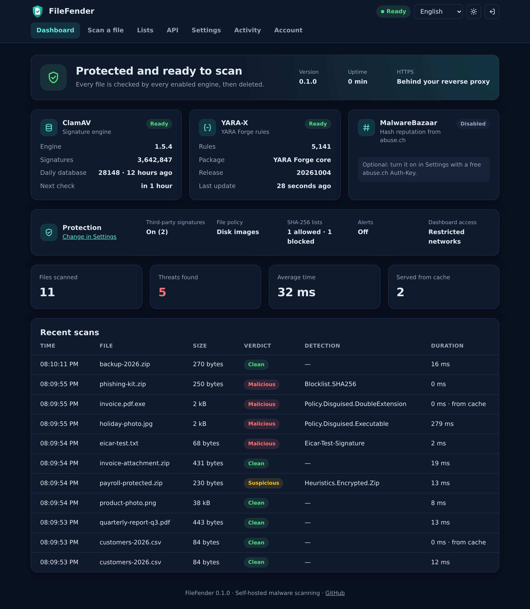<br>
  <sub>The dashboard of a test instance, a few minutes after installing it.</sub>
</p>

<p align="center">
  <a href="#install">🚀 Install</a> ·
  <a href="#scan">📲 Scan a file</a> ·
  <a href="#features">✨ Features</a> ·
  <a href="#settings">⚙️ Settings</a> ·
  <a href="#security">🔐 Security</a> ·
  <a href="#faq">❓ FAQ</a>
</p>

---

> [!IMPORTANT]
> FileFender is young software. Test it with your own files before relying on it. A malware scan lowers the risk of a file; a `clean` verdict never proves that a file is safe.

<a id="install"></a>

## 🚀 Install in one command

You need:

- an Ubuntu 22.04/24.04 or Debian 12/13 server, `amd64` or `arm64`;
- `root` access or a user with `sudo`;
- 2 vCPU and 4 GB RAM (2 GB works in low-memory mode), 5 GB of free disk;
- TCP ports `80` and `443` open in the provider firewall;
- a domain name pointing to the server, **or** a free [DuckDNS](https://www.duckdns.org/) subdomain, **or** an existing HTTPS reverse proxy.

Run this command on the server:

```bash
curl -fsSL https://raw.githubusercontent.com/drslid/FileFender/v0.1.0/install.sh | sudo bash
```

The installer asks how clients reach the server (your domain, DuckDNS or your reverse proxy), then:

1. checks the system, architecture, memory, disk, DNS record and free ports;
2. installs Docker Engine and Docker Compose when they are missing;
3. writes `/opt/filefender/compose.yaml` and its `.env` file (mode `0600`);
4. pulls the multi-architecture image from GHCR and starts it;
5. waits for the engines, then for the Let's Encrypt certificate;
6. enables the daily image update timer.

At the end, the terminal prints the dashboard address:

```text
FileFender is running.
  Dashboard:  https://scan.example.com/
  Next step:  open the dashboard now and create the administrator account.
              For safety the page closes 30 minutes after start; docker restart filefender reopens it.
  API keys:   create one per application in the dashboard, API tab
  Settings:   signature feeds, YARA, MalwareBazaar, file policy and alerts in the Settings tab
  Updates:    signatures and YARA rules as set in the dashboard, image daily with rollback (filefender-update.timer)
  Files:      /opt/filefender
```

**Open the dashboard right away: the first visitor creates the administrator account.** Then:

1. turn on two-factor authentication in **Account**;
2. create one API key per application in **API**;
3. look at **Settings**: limit the dashboard to your networks, add a webhook for alerts, choose your feeds and file policy;
4. add an account for each person who uses the dashboard, in **Account**, with the role that fits.

Running the installer again keeps your settings, accounts and keys, and repairs or upgrades the installation.

<p align="center">
  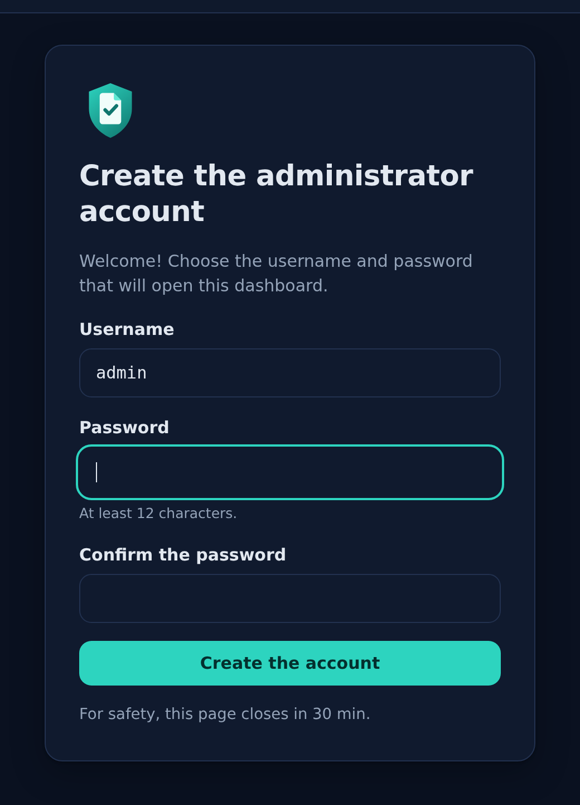
</p>

<details>
<summary>Unattended install</summary>

Every question has an environment variable. With `FILEFENDER_YES=1` the installer never prompts:

```bash
curl -fsSL https://raw.githubusercontent.com/drslid/FileFender/v0.1.0/install.sh | \
  sudo env FILEFENDER_YES=1 FILEFENDER_MODE=domain FILEFENDER_DOMAIN=scan.example.com \
           FILEFENDER_ACME_EMAIL=ops@example.com bash
```

| Variable | Meaning |
| --- | --- |
| `FILEFENDER_MODE` | `domain`, `duckdns` or `proxy` |
| `FILEFENDER_DOMAIN` | Host name, or the DuckDNS subdomain in `duckdns` mode |
| `FILEFENDER_DUCKDNS_TOKEN` | DuckDNS account token |
| `FILEFENDER_ACME_EMAIL` | Optional Let's Encrypt contact |
| `FILEFENDER_ABUSECH_AUTH_KEY` | Optional key that turns on MalwareBazaar (also settable in the dashboard) |
| `FILEFENDER_AUTO_UPDATE` | `yes` (default) or `no` for the daily image update |
| `FILEFENDER_TAG` | Image tag to follow, `stable` by default |

</details>

<a id="scan"></a>

## 📲 Scan a file from your application

Create a key for the application in the dashboard (**API** tab). Then send the file as a multipart field named `file`, or as the raw request body:

```bash
curl -H "Authorization: Bearer $FILEFENDER_KEY" -F file=@invoice.pdf https://scan.example.com/v1/scan

curl -H "Authorization: Bearer $FILEFENDER_KEY" --data-binary @invoice.pdf \
  "https://scan.example.com/v1/scan?filename=invoice.pdf"
```

The answer is the complete report. This one is real, for the harmless [EICAR test file](https://www.eicar.org/download-anti-malware-testfile/):

```json
{
  "verdict": "malicious",
  "file": { "name": "eicar.txt", "size": 68, "sha256": "275a021bbfb6489e54d471899f7db9d1663fc695ec2fe2a2c4538aabf651fd0f", "type": null },
  "threats": [
    { "engine": "clamav", "name": "Eicar-Test-Signature", "severity": "malicious" },
    { "engine": "yara", "name": "TRELLIX_ARC_Malw_Eicar", "severity": "malicious",
      "description": "Rule to detect the EICAR pattern", "score": 75, "reference": "https://www.eicar.org/" }
  ],
  "engines": {
    "clamav": { "status": "ok", "version": "1.5.4", "signatures": "main:63,daily:28148,bytecode:339,feeds:c7706302ba2e" },
    "malwarebazaar": { "status": "disabled" },
    "policy": { "status": "ok" },
    "yara": { "status": "ok", "version": "1.21.0", "signatures": "YARA Forge core 20261004 (5141 rules)" }
  },
  "cached": false,
  "duration_ms": 3,
  "scanned_at": "2026-10-09T16:46:03Z"
}
```

| Verdict | Meaning | Suggested action |
| --- | --- | --- |
| `clean` | No engine and no rule found anything | Accept |
| `suspicious` | Heuristic hit: encrypted archive, broken program, low-score YARA rule, potentially unwanted program, risky link or attachment from a third-party feed | Reject, or quarantine for review |
| `malicious` | Known malware signature, high-score YARA rule, hash known to MalwareBazaar, your blocklist, or your file policy | Reject |

Treat every non-`200` answer as **not scanned**. If ClamAV or YARA fails on a file, FileFender answers `500 scan_failed`; it never turns an engine error into `clean`. While the engines start, or when every scan slot is busy, it answers `503` with a `Retry-After` header.

<p align="center">
  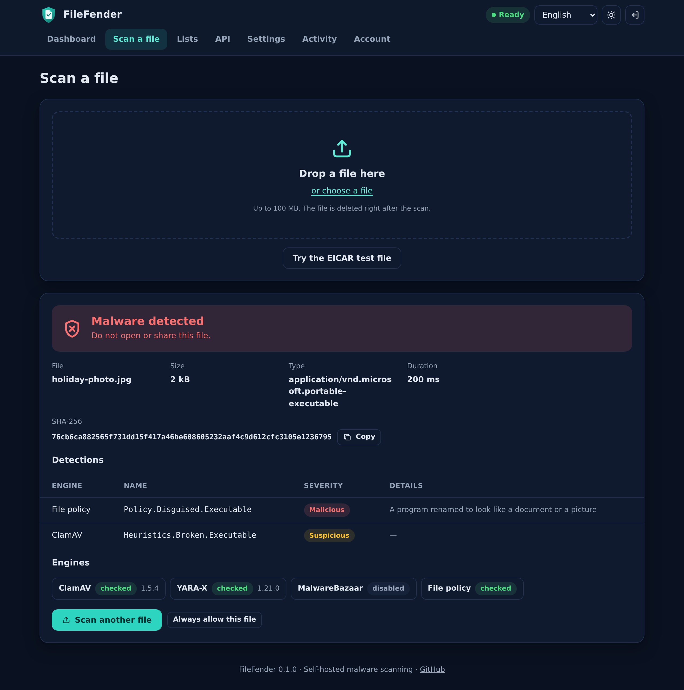<br>
  <sub>Drag a file on the <b>Scan a file</b> page: here a Windows program renamed <code>holiday-photo.jpg</code>.</sub>
</p>

<details>
<summary>Node.js and Python examples</summary>

```js
// Node.js 20+: streams the file from disk.
import { openAsBlob } from "node:fs";

const form = new FormData();
form.append("file", await openAsBlob("invoice.pdf"), "invoice.pdf");
const response = await fetch("https://scan.example.com/v1/scan", {
  method: "POST",
  headers: { Authorization: `Bearer ${process.env.FILEFENDER_KEY}` },
  body: form,
});
if (!response.ok) throw new Error(`not scanned: HTTP ${response.status}`);
const report = await response.json();
if (report.verdict !== "clean") throw new Error(`rejected: ${report.verdict}`);
```

```python
import os
import requests

with open("invoice.pdf", "rb") as f:
    response = requests.post(
        "https://scan.example.com/v1/scan",
        headers={"Authorization": f"Bearer {os.environ['FILEFENDER_KEY']}"},
        files={"file": ("invoice.pdf", f)},
        timeout=300,
    )
response.raise_for_status()  # any error means the file was not scanned
if response.json()["verdict"] != "clean":
    raise ValueError("file rejected")
```

</details>

<details>
<summary>All endpoints and error codes</summary>

| Endpoint | Auth | Purpose |
| --- | --- | --- |
| `POST /v1/scan` | Key | Scan one file (multipart `file` field or raw body, `?filename=` optional) |
| `GET /v1/hashes/{sha256}` | Key | Verdict already known for this SHA-256: your lists, or a recent scan with the current signatures; else `404` |
| `GET /v1/status` | Key | Engines, signatures, feeds, protections, counters and recent scans |
| `GET /metrics` | Key | Prometheus metrics |
| `GET /healthz` | None | Liveness |
| `GET /readyz` | None | `200` once every enabled engine is ready, else `503` |

The key goes in `Authorization: Bearer <key>` or `X-API-Key: <key>`. Errors are JSON, for example `{"error": {"code": "file_too_large", "message": "..."}}`:

| Status | Codes |
| --- | --- |
| `400` | `missing_file`, `bad_request`, `bad_hash` |
| `401` | `unauthorized`, `key_expired` |
| `403` | `ip_not_allowed` (the key is limited to other networks) |
| `404` | `unknown_hash`, `not_found` |
| `408` | `upload_timeout` |
| `413` | `file_too_large` (100 MB by default) |
| `429` | `queue_full`, `rate_limited` (the key's per-minute limit), `too_many_failures` (20 failures from one address in 15 minutes) |
| `500` | `scan_failed`, `storage_error` |
| `503` | `not_ready`, `busy`, `engine_unavailable`, with `Retry-After` |

The dashboard uses `/v1/setup`, `/v1/session`, `/v1/users`, `/v1/keys`, `/v1/account/*`, `/v1/settings`, `/v1/hashlist`, `/v1/webhooks/test` and `/v1/audit` with its session cookie; API keys cannot call them.

</details>

<a id="features"></a>

## ✨ What FileFender does

FileFender is a malware-scanning service for applications that accept files from users: web forms, document portals, mail gateways, CI pipelines. It runs on one server as one Docker container, with nothing else to operate. Uploaded files are streamed to disk, checked, then deleted; they are never stored.

Each file goes through:

1. **your SHA-256 lists**: a file you allowed or blocked gets your verdict at once;
2. **the verdict cache**: the same file with the same signatures is answered from memory;
3. **the engines, in parallel**:
   - **ClamAV 1.5**, the official engine and its 3.6 million signatures, with archive, document, PDF, mail and program parsing and heuristics, plus the third-party feeds you turn on;
   - **YARA-X 1.21** with the [YARA Forge](https://yarahq.github.io/) rules (5,000+ curated community rules in the `core` package), compiled in-process;
   - **MalwareBazaar** hash reputation from abuse.ch, optional, with a free Auth-Key;
4. **your file policy**: types you refuse, and programs that hide behind a document name;
5. **one verdict**: the most severe result wins.

Around it:

- 🔒 Automatic HTTPS from Let's Encrypt, optional DuckDNS updates, or plain HTTP behind your proxy.
- 🔄 Signature and rule updates without downtime; image updates with automatic rollback.
- 👥 Accounts for your team with three roles (viewer, operator, administrator), each with optional two-factor authentication (authenticator app and single-use recovery codes).
- 🔑 API keys created, restricted and revoked from the dashboard or the command line, stored hashed.
- 🔔 Alerts to Discord, Slack, ntfy or any webhook, signed with HMAC-SHA256: threats found, outdated signatures, engine failures, security events.
- 📜 An activity log of who signed in and who changed what.
- 📊 Prometheus metrics and a dashboard to watch the engines and scan a file by drag and drop, on desktop and phone, light and dark.
- 🌍 English, Spanish, French, German, Simplified Chinese, Arabic, Russian, Portuguese, Hindi and Urdu.

<a id="settings"></a>

## ⚙️ Settings

### From the dashboard

Everything that changes detection is in **Settings**, and applies within seconds without a restart. The values come first from the `.env` file; once you save the page, the dashboard wins (they are kept in `settings.json` on the data volume).

<p align="center">
  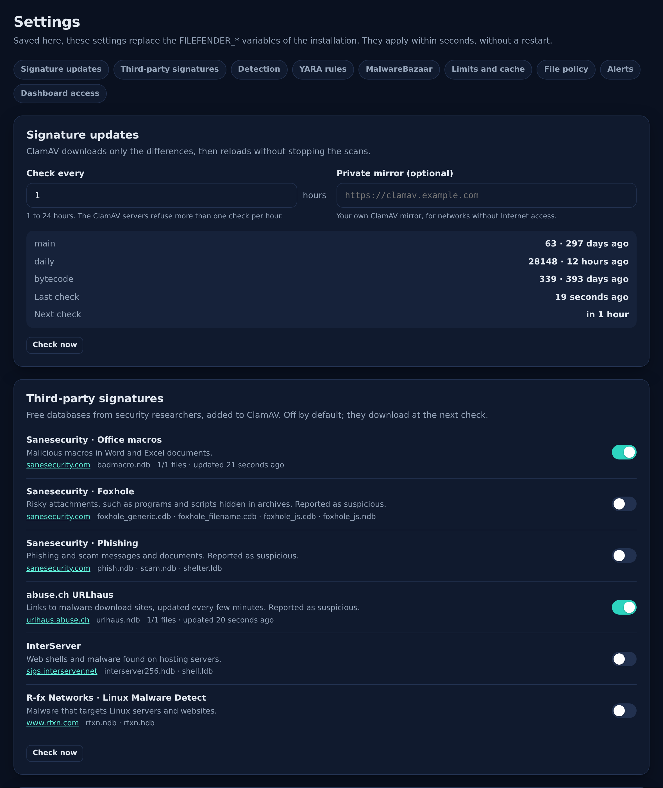
</p>

| Section | What you can change |
| --- | --- |
| **Signature updates** | Check interval (1 to 24 hours), a private ClamAV mirror, **Check now**, database versions |
| **Third-party signatures** | Free feeds added to ClamAV, off by default (table below) |
| **Detection** | Encrypted archives, Office macros, potentially unwanted programs, heuristics, broken programs, phishing, archive depth and size |
| **YARA rules** | On or off, `core`, `extended` or `full` package, score from which a rule is `malicious`, check interval, **Check now** |
| **MalwareBazaar** | On or off, and the abuse.ch Auth-Key (never shown again once saved) |
| **Limits and cache** | Largest file (up to 2 GB), scan time limit, how long verdicts are remembered |
| **File policy** | Disguised files, and file types to refuse (table below) |
| **Alerts** | Webhooks and the events each one receives |
| **Dashboard access** | Addresses and networks allowed to open the dashboard |

#### Third-party signatures

| Feed | Finds | Verdict |
| --- | --- | --- |
| [Sanesecurity](https://sanesecurity.com/) · Office macros | Malicious macros in Word and Excel documents | `malicious` |
| [Sanesecurity](https://sanesecurity.com/) · Foxhole | Risky attachments, such as programs and scripts hidden in archives | `suspicious` |
| [Sanesecurity](https://sanesecurity.com/) · Phishing | Phishing and scam messages and documents | `suspicious` |
| [abuse.ch URLhaus](https://urlhaus.abuse.ch/) | Links to malware download sites, updated every few minutes | `suspicious` |
| [InterServer](https://sigs.interserver.net/) | Web shells and malware found on hosting servers | `malicious` |
| [R-fx Networks](https://www.rfxn.com/projects/linux-malware-detect/) · Linux Malware Detect | Malware that targets Linux servers and websites | `malicious` |

`freshclam` downloads them over HTTPS at the next check. Only detection databases are accepted, so a feed can never whitelist a file. They are not part of the image: their authors' terms apply.

#### File policy

<p align="center">
  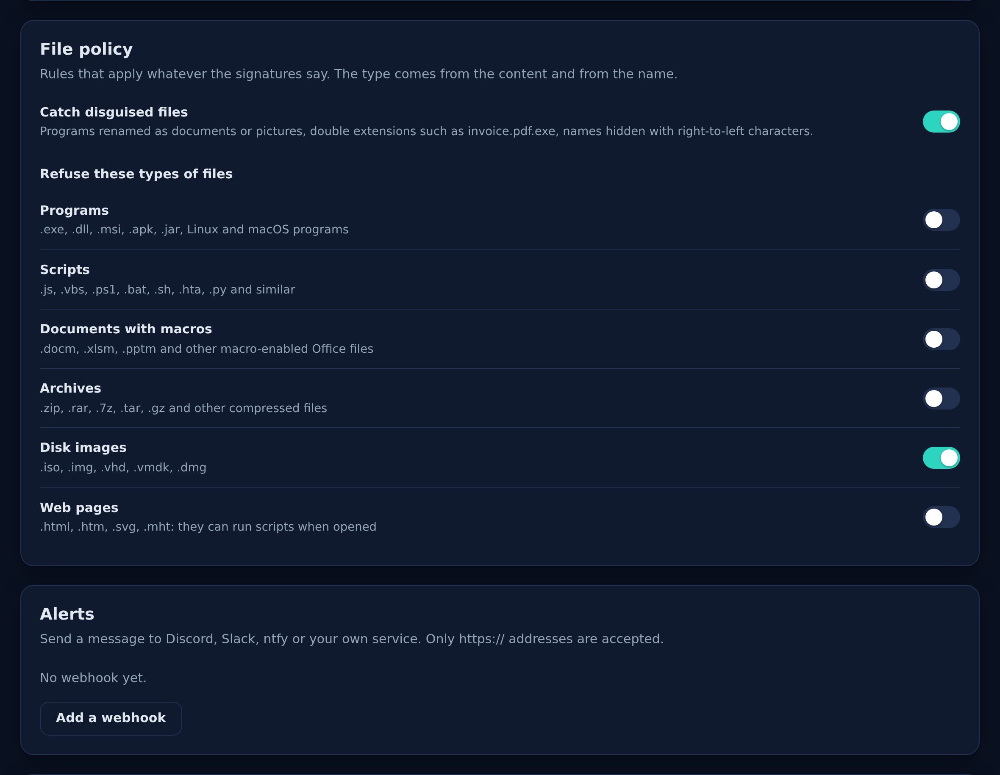
</p>

The type of a file comes from its content (magic bytes) **and** its name, so renaming a file does not get it through:

- **Disguised files** (on by default): a program named like a document or a picture (`holiday-photo.jpg` that is really a Windows program), a double extension such as `invoice.pdf.exe`, a name that uses right-to-left characters to hide its real extension.
- **Refused types**, each optional: programs, scripts, documents with macros, archives, disk images, web pages.

Policy hits are `malicious`, with a `Policy.*` name in the report, so your application rejects them like malware.

#### Alerts

<p align="center">
  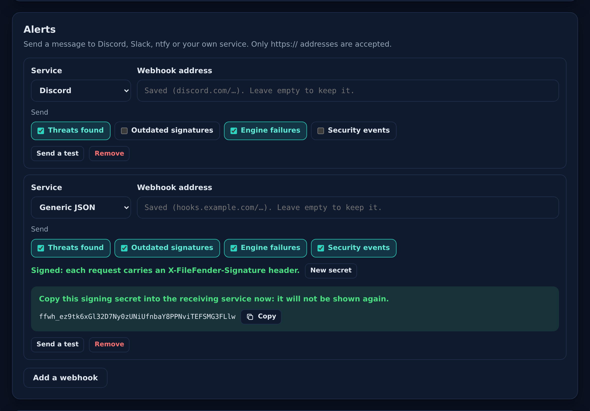
</p>

Add up to 20 webhooks: **Discord**, **Slack**, **ntfy** (`https://ntfy.sh/your-topic`, or your own server) or **generic JSON**. Each one picks its events:

| Event | When |
| --- | --- |
| Threats found | A `malicious` or `suspicious` file, once per file and per hour |
| Outdated signatures | The ClamAV daily database is more than 48 hours old, and when it is fresh again |
| Engine failures | ClamAV or YARA stops working (scans are refused), and when it works again |
| Security events | Sign-ins, account and two-factor changes, recovery codes, API keys, setting and list changes, an address blocked after repeated failures |

Only `https://` addresses are accepted and redirects are never followed. Webhook addresses often contain a secret: once saved, the dashboard only shows their host. A generic webhook receives:

```json
{
  "event": "threats",
  "level": "critical",
  "title": "Malicious file: invoice.exe",
  "text": "Eicar-Test-Signature (clamav)\nSHA-256 275a021b…\nSent by key billing-app from 203.0.113.7",
  "service": "scan.example.com",
  "at": "2026-10-09T16:46:03Z",
  "data": {
    "verdict": "malicious",
    "file": { "name": "invoice.exe", "size": 68, "sha256": "275a021b…", "type": null },
    "threats": [{ "engine": "clamav", "name": "Eicar-Test-Signature", "severity": "malicious" }],
    "caller": "key billing-app",
    "ip": "203.0.113.7"
  }
}
```

Generic webhooks are signed. When you save one, FileFender creates its signing secret (`ffwh_…`) and shows it once: copy it into the receiving service. **New secret** replaces it. Each request carries two headers:

```http
X-FileFender-Event: threats
X-FileFender-Signature: t=1791000000,v1=e6f0ab3df88d73aa8dba094d9cf88efe77b82757cf270978b1a784871bf313a6
```

`v1` is the HMAC-SHA256 of `<t>.<raw body>`, in hex, keyed with the whole secret. Check it on the raw bytes before parsing the JSON, and refuse old timestamps. Discord, Slack and ntfy are not signed: their address is the secret, which is why the dashboard never shows it again.

<details>
<summary>Checking the signature in Node.js and Python</summary>

```js
import { createHmac, timingSafeEqual } from "node:crypto";

// rawBody: the request body exactly as received (a Buffer, for example from express.raw()).
export function fromFileFender(rawBody, header, secret) {
  const match = /^t=(\d+),v1=([0-9a-f]{64})$/.exec(header ?? "");
  if (!match) return false;
  const [, t, v1] = match;
  if (Math.abs(Date.now() / 1000 - Number(t)) > 300) return false; // late or replayed
  const expected = createHmac("sha256", secret).update(`${t}.`).update(rawBody).digest();
  return timingSafeEqual(expected, Buffer.from(v1, "hex"));
}
```

```python
import hashlib
import hmac
import re
import time


def from_filefender(raw_body: bytes, header: str, secret: str) -> bool:
    match = re.fullmatch(r"t=(\d+),v1=([0-9a-f]{64})", header or "")
    if not match:
        return False
    t, v1 = match.groups()
    if abs(time.time() - int(t)) > 300:  # late or replayed
        return False
    expected = hmac.new(secret.encode(), t.encode() + b"." + raw_body, hashlib.sha256).hexdigest()
    return hmac.compare_digest(expected, v1)
```

</details>

#### Dashboard access

When the list is not empty, only these addresses and networks can open the dashboard; API keys are not affected. FileFender refuses a list that would lock out your current address. If you lock yourself out anyway, run `docker exec filefender filefender admin unlock-dashboard` on the server.

### SHA-256 lists

<p align="center">
  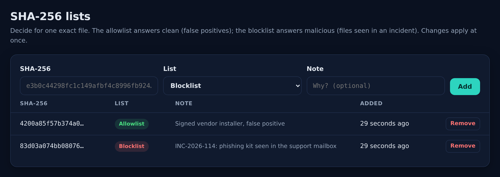
</p>

In **Lists**, the allowlist answers `clean` for one exact file (a false positive you checked); the blocklist answers `malicious` (a file seen in an incident, before signatures know it). Changes apply at once. In the dashboard, a scan report also offers to always block or always allow its file.

### API keys

In **API**, name an application and create its key: it is shown once. **Restrict** limits a key to the addresses of your servers, to a number of requests per minute, and to an expiry date. The list shows when and from where each key was last used.

<p align="center">
  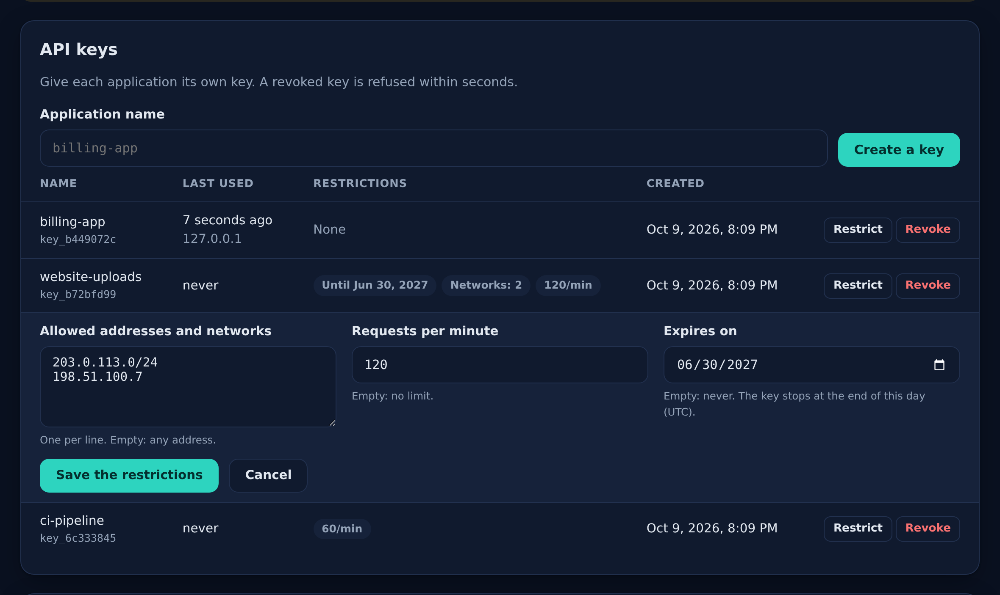
</p>

The same is available on the server, for scripts:

```bash
docker exec filefender filefender keys create my-app   # prints a new key once
docker exec filefender filefender keys list
docker exec filefender filefender keys revoke my-app   # refused within seconds
```

### Accounts and roles

Give each person their own account in **Account → Accounts**: the activity log then shows who did what.

| Role | Can |
| --- | --- |
| Viewer | See the dashboard and the activity |
| Operator | Also scan files from the dashboard and edit the SHA-256 lists |
| Administrator | Also change the settings, the API keys and the accounts |

<p align="center">
  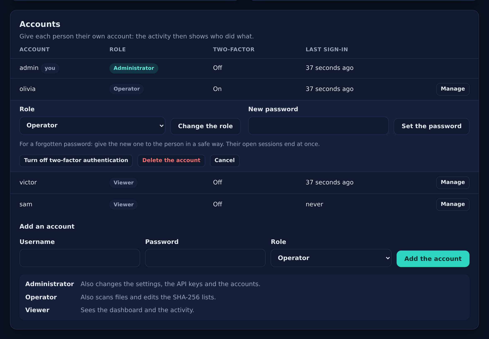
</p>

The server checks the role on every request, and a change applies at once, even to open sessions. **Manage** changes the role, sets a new password for someone who forgot theirs (their sessions end), turns off two-factor authentication after a lost phone, or deletes the account. Administrators change their own password and two-factor authentication in **Account**; they cannot demote or delete themselves, so one administrator always remains.

If no administrator can sign in any more, use the server:

```bash
docker exec filefender filefender admin status   # accounts, roles and two-factor state
docker exec filefender filefender admin reset    # deletes every account
docker exec filefender filefender admin unlock-dashboard
```

After `admin reset`, open the dashboard within 30 minutes to create the administrator account again, then add the others back. API keys keep working.

### Activity

<p align="center">
  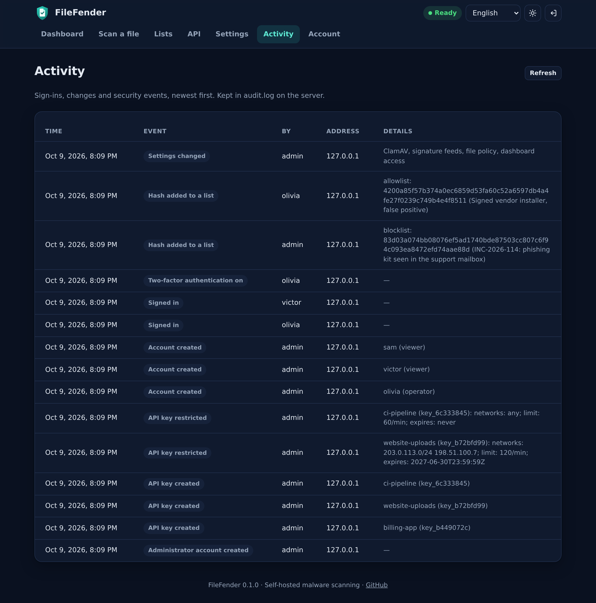
</p>

**Activity** lists sign-ins, refused sign-ins, account, key, list and setting changes, with who did it and from which address, newest first. Every role can read it. The log is `audit.log` on the data volume (owner-only, rotated at 2 MB).

### Environment variables

The installer keeps them in `/opt/filefender/.env`. Change a value, then run `cd /opt/filefender && sudo docker compose up -d`. The ones marked ⚙️ only give the first value of a dashboard setting.

| Variable | Default | Purpose |
| --- | --- | --- |
| `FILEFENDER_DOMAIN` | | Public host name; turns on HTTPS on ports `80`/`443` |
| `FILEFENDER_ACME_EMAIL` | | Let's Encrypt contact address |
| `FILEFENDER_DUCKDNS_TOKEN` | | Keeps `<name>.duckdns.org` pointed at the server |
| `FILEFENDER_TRUST_PROXY_HEADERS` | `false` | Read the client address from `X-Forwarded-For` (proxy mode) |
| `FILEFENDER_SETUP_WINDOW` | `30m` | How long after start the administrator account can be created; `0` removes the limit |
| `FILEFENDER_MAX_CONCURRENT_SCANS` | CPU count, 2 to 16 | Files scanned at the same time |
| `FILEFENDER_MAX_PENDING_SCANS` | 8 × concurrent | Uploads accepted before `429 queue_full` |
| `FILEFENDER_QUEUE_TIMEOUT` | `30s` | Wait for a scan slot before `503 busy` |
| `FILEFENDER_UPLOAD_TIMEOUT` | `10m` | Time allowed to receive an upload |
| `FILEFENDER_LOW_MEMORY` | `false` | For 2 to 3.5 GB of RAM: scans pause for a few seconds during reloads |
| `FILEFENDER_LOG_FORMAT` | `text` | `json` for log collectors |
| `FILEFENDER_YARA_RULES_URL` | | Download the rules archive from this address instead of YARA Forge (same layout) |
| ⚙️ `FILEFENDER_MAX_FILE_SIZE` | `100M` | Largest upload, from `1K` to `2G` |
| ⚙️ `FILEFENDER_SCAN_TIMEOUT` | `2m` | Scan time limit |
| ⚙️ `FILEFENDER_CACHE_TTL` | `6h` | How long verdicts are remembered |
| ⚙️ `FILEFENDER_ALERT_ENCRYPTED` | `true` | Encrypted archives and documents are `suspicious` |
| ⚙️ `FILEFENDER_ALERT_MACROS` | `false` | Office documents with macros are `suspicious` |
| ⚙️ `FILEFENDER_DETECT_PUA` | `false` | Report potentially unwanted programs |
| ⚙️ `FILEFENDER_YARA` | `true` | Turn on YARA-X |
| ⚙️ `FILEFENDER_YARA_PACKAGE` | `core` | YARA Forge package: `core`, `extended` or `full` |
| ⚙️ `FILEFENDER_YARA_MALICIOUS_SCORE` | `70` | Rules scored below this are `suspicious` |
| ⚙️ `FILEFENDER_ABUSECH_AUTH_KEY` | | Turns on MalwareBazaar ([free key](https://auth.abuse.ch/)) |
| ⚙️ `FILEFENDER_UPDATE_INTERVAL` | `1h` | Signature check interval, one hour at least |
| ⚙️ `FILEFENDER_CLAMAV_PRIVATE_MIRROR` | | Your own ClamAV database mirror |

### Without the installer

The image runs anywhere Docker runs. With a domain pointing to the host:

```bash
docker run -d --name filefender --restart unless-stopped -p 80:80 -p 443:443 \
  -e FILEFENDER_DOMAIN=scan.example.com -v filefender-data:/data \
  --read-only --tmpfs /tmp --cap-drop ALL --security-opt no-new-privileges \
  ghcr.io/drslid/filefender:stable
# then open https://scan.example.com/ and create the administrator account
```

Without `FILEFENDER_DOMAIN`, FileFender serves plain HTTP on port `8080` for a reverse proxy: publish it on `127.0.0.1:8080:8080` and set `FILEFENDER_TRUST_PROXY_HEADERS=true`. The repository's [compose.yaml](compose.yaml) is the same setup for Docker Compose.

## 🔄 How it stays up to date

| What | How often | How |
| --- | --- | --- |
| ClamAV signatures and feeds | Every hour by default (Settings) | `freshclam` inside the container, then a live reload of `clamd`: scans keep running |
| YARA rules | Every day by default (Settings) | Latest YARA Forge release, compiled in the background, then swapped in |
| Container image | Every day | `filefender-update.timer` pulls the `stable` tag; if the new container is not healthy within 10 minutes, the previous image comes back |
| Image contents | Every week | The release workflow rebuilds the image on the latest official ClamAV image |

The image ships the official signatures, so a new installation scans within seconds of starting. To update right away, use **Check now** in Settings, or:

```bash
docker kill --signal HUP filefender            # signatures and rules now
sudo systemctl start filefender-update.service  # image now
```

## 🧭 Architecture

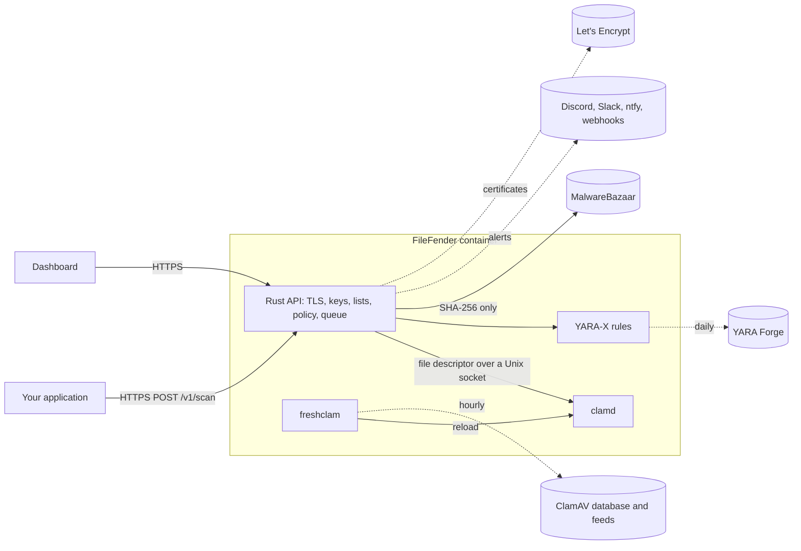

`tini` runs as PID 1 and starts a single Rust process. That process terminates TLS, renews the certificate (TLS-ALPN-01, port `443`), authenticates dashboard accounts and API keys, applies the lists and the file policy, queues scans, sends alerts, and supervises `clamd` and `freshclam`. `clamd` only listens on a private Unix socket and receives each upload as a file descriptor, so files are never copied over a network socket. Everything persistent lives in the `filefender-data` volume: accounts, keys, settings, lists, activity log, certificates, signatures and compiled YARA rules.

<a id="security"></a>

## 🔐 How it works and why it is safe

- **First visit.** Until an account exists, whoever opens the dashboard first creates the administrator account: do it right after installing. The page closes 30 minutes after start (`FILEFENDER_SETUP_WINDOW`); after that, only an administrator adds accounts.
- **Accounts.** Passwords are hashed with Argon2id. Two-factor codes are accepted once, and each recovery code works once. The session is an `HttpOnly`, `SameSite=Strict` cookie (`Secure` over HTTPS) kept in memory: a restart, a sign-out, a password change or a reset by an administrator ends it. The server checks the role of the account on every request. Every change also requires a header that other websites cannot send.
- **Dashboard access.** You can limit the dashboard to your networks; FileFender refuses a list that would lock out your current address.
- **API keys.** 256-bit random values, shown once, stored as SHA-256 hashes in a `0600` file. Each can be limited to networks, to a request rate and to an expiry date.
- **Brute force.** Twenty failed sign-ins, codes or API keys from one address (IPv6: one `/64`) block it for 15 minutes, and raise a security alert.
- **Uploads.** Files go to a private directory, are scanned, then deleted. Only the SHA-256 leaves the server, and only when MalwareBazaar is on.
- **Secrets.** `settings.json`, accounts, keys and lists are owner-only files. The dashboard never shows the abuse.ch key, a webhook address or a signing secret again once saved.
- **Alerts.** Webhooks only accept `https://` and never follow redirects; generic webhooks are signed with HMAC-SHA256; Discord mentions are disabled and Slack markup is escaped, so a file name cannot ping your team.
- **Container.** It runs as an unprivileged user, with a read-only root filesystem, no Linux capabilities and `no-new-privileges`. `clamd` has no TCP port; its Unix socket is private to the container user.
- **Web.** HTTPS uses rustls with HSTS, and the dashboard sends a strict Content Security Policy.
- **Fail closed.** A file is `clean` only when every enabled engine says so; engine errors are never turned into `clean`.

Signature engines find known threats and common malicious patterns. They can miss new or targeted malware, so keep other layers: file type checks, size limits, least privilege where files are opened. YARA Forge distributes community rules under their authors' licenses; FileFender downloads them at run time and does not ship them. Use MalwareBazaar within the [abuse.ch terms](https://abuse.ch/terms-of-use/).

## 📱 On your phone, in your language

The dashboard works on phones, in light and dark, and in 10 languages, including right-to-left Arabic and Urdu. It follows the browser language; the menu at the top changes it.

<p align="center">
  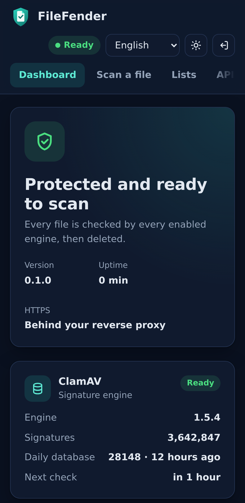
  &nbsp;
  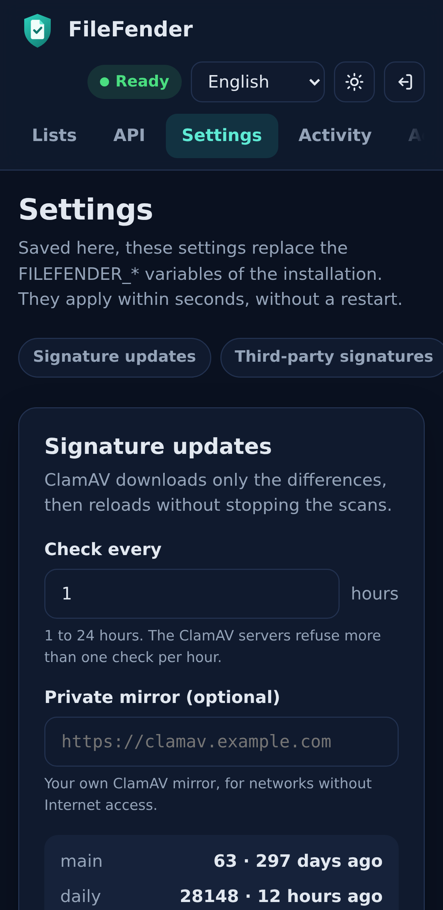
</p>

<p align="center">
  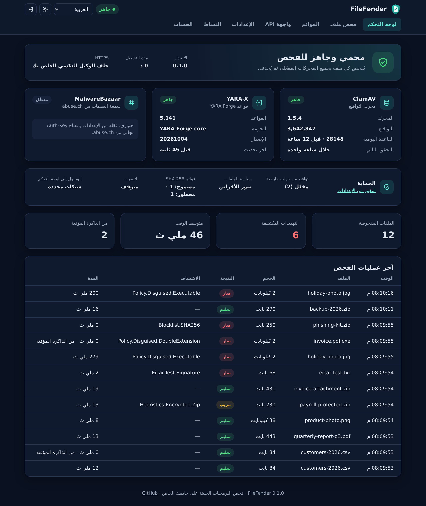
</p>

## 📏 Sizing and performance

| | Recommended | Minimum |
| --- | --- | --- |
| CPU | 2 vCPU | 1 vCPU |
| RAM | 4 GB | 2 GB, with `FILEFENDER_LOW_MEMORY=true` (set by the installer) |
| Free disk | 5 GB | 4 GB (checked by the installer) |

`clamd` keeps its signatures in memory (about 1 GB) and briefly needs twice that while it reloads new signatures. FileFender itself uses less than 100 MB.

### Benchmarks

[scripts/bench.mjs](scripts/bench.mjs) sends generated files to a running instance: first one at a time, then from 16 parallel clients. Every file has random content, so no verdict comes from the cache. Measured on 2026-10-09 with the published image v0.1.0 and its default settings: ClamAV 1.5.4 with 3.6 million signatures, YARA Forge `core` with 5,141 rules, MalwareBazaar off.

| File | Size | One file alone | GitHub runner, 4 vCPU | Server, 8 vCPU |
| --- | ---: | ---: | ---: | ---: |
| CSV text | 20 kB | 14 ms | 181 files/s | 287 files/s |
| PDF with a picture | 246 kB | 85 ms | 28 files/s | 43 files/s |
| Word document | 147 kB | 157 ms | 16.5 files/s | 30 files/s |
| PNG picture | 2.0 MB | 111 ms | 25 files/s, 49 MB/s | 43 files/s, 86 MB/s |
| ZIP of 20 files | 5.0 MB | 4.1 s | 0.6 files/s, 3 MB/s | 1.1 files/s, 5 MB/s |
| Binary file | 25 MB | 0.97 s | 2.0 files/s, 51 MB/s | 3.3 files/s, 83 MB/s |

- **One file alone** is the median time of a request, upload included, on the GitHub runner; the 8 vCPU server is within about 10%.
- With 16 parallel clients, FileFender scans as many files at a time as the server has CPUs, and the other uploads wait in the queue.
- The EICAR test file is detected in 3 to 5 ms. A file scanned before is answered from the cache in 1 to 2 ms.
- ZIP files, and Office documents, which are ZIP files inside, are the slow case: ClamAV inspects them at about 0.8 s per MB of archive. The official `clamscan` 1.5.4 takes as long with the same signatures, and turning YARA off changes nothing. A 100 MB archive of photos takes more than a minute, so raise the scan time limit if you accept large archives.
- The container used 1.1 to 1.2 GiB of memory when idle, and 1.6 to 2.0 GiB at most during the run. It was ready 9 to 10 seconds after `docker run`.
- Machines: a GitHub-hosted `ubuntu-24.04` runner (4 vCPU AMD EPYC 9V74, 16 GB), and a virtual machine with 8 vCPU AMD EPYC 7763 and 32 GB, shared with other services.

To measure your own hardware, start the **Benchmark** workflow from the Actions tab of your fork, or run the script from a clone of this repository (Node.js 20 or later) against a test instance:

```bash
docker exec filefender filefender keys create bench   # prints the key once
FILEFENDER_URL=https://scan.example.com FILEFENDER_KEY=ff_... node scripts/bench.mjs
```

The run sends about 1 GB in 1,000 scans, which then appear in the dashboard counters.

<a id="faq"></a>

## ❓ FAQ

<details>
<summary><b>Does a <code>clean</code> verdict mean that a file is safe?</b></summary>

No. It means that no engine, rule or list recognized it. New or targeted malware can get through. Keep the file away from anything that runs it, and open it with the least privileges possible.

</details>

<details>
<summary><b>Does FileFender keep my files, or send them anywhere?</b></summary>

No. A file is written to a private temporary file, scanned, then deleted. Only its SHA-256 leaves the server, to abuse.ch, and only if you turn MalwareBazaar on. Webhook alerts contain the file name and hash, never its content.

</details>

<details>
<summary><b>Can I run it without a domain name?</b></summary>

Yes: with a free DuckDNS subdomain (the installer keeps it pointed at your server), or behind your own HTTPS reverse proxy (`proxy` mode, plain HTTP on `127.0.0.1:8080`).

</details>

<details>
<summary><b>A legitimate file is flagged. What do I do?</b></summary>

Open its report in the dashboard and click **Always allow this file**: its exact SHA-256 goes to the allowlist. Report false positives to [ClamAV](https://www.clamav.net/reports/fp) or to the author of the YARA rule or feed, so others benefit too.

</details>

<details>
<summary><b>I forgot my password, lost my phone, or locked myself out of the dashboard.</b></summary>

Another administrator can help: **Account → Accounts → Manage** sets a new password or turns off two-factor authentication. If no administrator can sign in, `docker exec filefender filefender admin reset` on the server deletes every account (create the administrator again within 30 minutes), and `docker exec filefender filefender admin unlock-dashboard` removes the network restriction. Both are written to the activity log.

</details>

<details>
<summary><b>How do I get alerts on my phone?</b></summary>

Install the [ntfy](https://ntfy.sh/) app, subscribe to a topic with a long random name, and add `https://ntfy.sh/that-topic` as an **ntfy** webhook in Settings. **Send a test** checks it right away.

</details>

<details>
<summary><b>Why do scans pause after I change the detection settings?</b></summary>

ClamAV reads them when it starts, so FileFender restarts it: from a few seconds to a minute, depending on the server. Scans wait meanwhile and nothing is answered `clean` by mistake. Other settings apply without any pause.

</details>

## ⚠️ Known limitations

- FileFender has not had an independent security audit.
- Accounts sign in with a password and optional two-factor authentication; there is no single sign-on yet.
- Third-party feeds and the `full` YARA package find more, but also flag more legitimate files: turn them on one at a time and use the allowlist.
- The file policy knows the common program, script, archive, disk image and web page formats; some formats are only recognized by their extension (ISO images, for example).
- A key restricted to some networks, and the dashboard allowlist, rely on the client address; behind a proxy, set `FILEFENDER_TRUST_PROXY_HEADERS=true` and make sure only the proxy can reach FileFender.
- When the server refuses an upload before reading it (wrong key, `413`), some HTTP clients report a broken connection (`EPIPE`) instead of the status code.

## 🗺️ Roadmap

- A Landlock sandbox around `clamd`, so a parser bug cannot reach the rest of the data volume.
- Images signed with Sigstore, and a verification step in the installer.
- Passkeys, and single sign-on with OpenID Connect.
- Your own YARA rules, written and tested from the dashboard.

## 🛠️ Development

```bash
cargo fmt --check
cargo clippy --all-targets -- -D warnings
cargo test                     # uses a mock clamd: no ClamAV needed
node scripts/check-web.mjs     # dashboard translations
docker build -t filefender .    # then: FILEFENDER_URL=... FILEFENDER_KEY=... scripts/smoke-test.sh
```

Without Docker, run `cargo run -- serve` with ClamAV installed locally and `FILEFENDER_DATA_DIR`, `FILEFENDER_CLAMD_BIN` and `FILEFENDER_FRESHCLAM_BIN` pointing to a writable directory and the ClamAV binaries.

```text
src/            API, scan pipeline, settings, file policy, lists, alerts, activity log, keys, TLS
src/clamav/     clamd and freshclam supervision, clamd protocol, third-party feeds
web/            Dashboard: plain HTML, CSS and JavaScript, no build step
scripts/        End-to-end smoke test, benchmark and translation check
install.sh      Server installer and update timer
Dockerfile      Multi-architecture image on top of the official ClamAV image
```

Report vulnerabilities privately as described in [SECURITY.md](SECURITY.md).

## 🤝 Help improve FileFender

Found a bug, a confusing message or a missing feature? [Open an issue](https://github.com/drslid/FileFender/issues). Translation fixes are welcome too: every language is in [web/i18n.js](web/i18n.js), and `node scripts/check-web.mjs` checks them.

## 👥 Contributors

<a href="https://github.com/drslid/FileFender/graphs/contributors">
  
</a>

## 📄 License

FileFender is available under the [MIT License](LICENSE). The container image also includes [ClamAV](https://github.com/Cisco-Talos/clamav), distributed by Cisco Talos under the GPL-2.0, and [tini](https://github.com/krallin/tini) under the MIT License.

<p align="right"><a href="#top">⬆️ Back to top</a></p>
